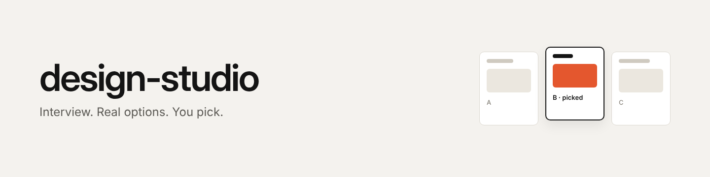
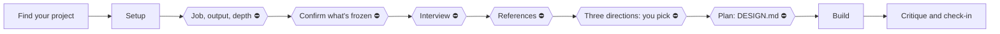

<p align="center">
  
</p>

<p align="center">
  A Claude skill that designs like a real designer: it interviews you, shows real options, and you pick.
</p>

<p align="center">
  
  
  
</p>

<p align="center">
  <a href="#install">Install</a> ·
  <a href="#how-it-works">How it works</a> ·
  <a href="skills/design-studio/reference/toolkit.md">Toolkit</a> ·
  <a href="CHANGELOG.md">Changelog</a> ·
  <a href="CONTRIBUTING.md">Contributing</a>
</p>

<!-- TODO: screenshot of a real run (the directions step, three options side by side), 1600px wide, saved as .github/assets/directions.png
<p align="center"></p>
-->

design-studio makes Claude (and other AI coding tools) work the way a designer works with a client. It asks what you're making, confirms what must stay the same, shows you real options to pick from, writes a plan, builds only what's needed, then checks the result against your own taste. It covers websites, app screens, dashboards, reports, printable PDFs and game interfaces.

> [!NOTE]
> v0.9 is early and tested on a handful of projects. Feedback and issues are welcome.

## Install

**Claude Code** (includes the automatic checks):
```
/plugin marketplace add AydinHeugh/design-studio
/plugin install design-studio@design-studio
```

**Any agent that supports skills:**
```
npx skills add AydinHeugh/design-studio
```

**Claude app:** zip the `skills/design-studio` folder and upload it under Customize → Skills → Upload a skill (code execution must be on).

**Other tools:** copy `skills/design-studio/` into your project and point your AI at `SKILL.md`.

Then ask for a design, or type `/design-studio`. It starts by asking what the job is, what you're making and how much time you want to spend.

## Why this exists

Ask an AI for a landing page and you get the same page: small label, headline with one colored word, gray subtext, two buttons, a card on the right. The AI knows every design principle. What it lacks is **experience**: no process, no memory of the client's taste, and nobody making it choose.

| A designer has... | design-studio gives the AI... |
|---|---|
| A process they trust | Nine steps, with hard stops where you decide |
| A client who decides | Real options to pick from; taste choices are never made for you |
| Memory of the client's taste | A `taste-profile.md` that grows every project |
| Engineering discipline | A `DESIGN.md` plan before any code |
| Checklists from past mistakes | A critique against your taste and common AI tells |

## What it's for

Pick the job. The skill shows what it will keep and change, and you confirm before anything happens.

| Job | Keeps | Changes |
|---|---|---|
| New | nothing (unless you say so) | everything |
| Rebrand | layout, flows, content | look, type, color, voice |
| Reskin | how everything works (UX) | how it looks (UI) |
| Redesign | content and goals | layout and look |
| Polish | everything you have | the details |

Then the output: landing page, app, dashboard, report, print/PDF or game. Each has its own rules (a report leads with what its readers need; a print handout works in black and white; an app's motion stays quiet).

**Two rules it never breaks:** only what's necessary (your content stays yours; suggestions come separately), and taste and readers come from you, never from the AI.

## How it works



⛔ marks a stop where Claude waits for your answer.

Every reply starts with the step it's on. Depth sets how much of your time it takes: **Light** (~2 min), **Moderate** (~10 min, default) or **Deep** (30+ min).

## Checks that keep it on track

Big skills get skimmed. v0.9 fixes that three ways:

1. **Short core, branch files.** `SKILL.md` is ~80 lines. The detail for each job, output and step lives in its own file, opened only when that path comes up.
2. **State file.** The skill keeps `.studio/state.json` in your project: step, job, whether you confirmed the frozen list, your pick.
3. **A check script** (`scripts/check.mjs`, Node, no dependencies):
   - Won't let it edit UI files before you've confirmed the job, picked a direction and the plan exists.
   - Won't let it finish before the critique is done.
   - Does nothing in projects where design-studio isn't active.

| Where | How the checks run |
|---|---|
| Claude Code (plugin) | Automatically, through hooks |
| Claude app, Cursor, Codex, others | The skill tells the AI to run `node check.mjs build` and `done`; you can run them too |
| GitHub | Optional workflow that checks `DESIGN.md` on every push ([template](skills/design-studio/templates/github-workflow.yml)) |

## Your taste

On first run it offers a short taste setup: real sites, fonts, palettes and motion, and you say what you like and why. It saves `.studio/taste-profile.md` in your project or `~/.studio/taste-profile.md` for all projects. When you say you dislike something, it becomes a rule straight away.

## Packs

Expert skills you switch on per project; only what you enable gets loaded. See [packs.md](skills/design-studio/reference/packs.md).

| Pack | From | For |
|---|---|---|
| `emil` | Emil Kowalski | Motion, feel, variant picker, stress tests |
| `impeccable` | Paul Bakaus | Critique and polish of existing UI |
| `motion` | GSAP, Motion, Three.js, Rive, Lottie | Motion identity for landing pages and games |
| `native-apple` | Apple HIG skills | Native iOS and macOS apps |

**Assets** you can pull from (icons, fonts, photos, 3D, connectors), with licences: [toolkit.md](skills/design-studio/reference/toolkit.md).

## Files

```
.claude-plugin/          plugin and marketplace manifests
hooks/hooks.json         Claude Code hooks that run the checks
skills/design-studio/
├── SKILL.md             the core: rules and the nine steps
├── jobs/                new, rebrand, reskin, redesign, polish
├── outputs/             landing, app, dashboard, report, print, game
├── reference/           one file per step, plus craft, motion, tells, toolkit
├── scripts/check.mjs    the checks
├── sources/             expert rules, credited
└── templates/           state, taste profile, GitHub workflow
```

In your project it writes `DESIGN.md` (the plan) and `.studio/` (state, critique, taste profile).

## Known issues

> [!WARNING]
> Hooks only run in Claude Code. In other tools the checks rely on the AI running them.

- Mobbin's connector needs a paid plan; the skill falls back to free galleries.
- It can't watch YouTube; new sources come in as transcripts or screenshots.

## Credits

Built on ideas and skills from Emil Kowalski (MIT), Paul Bakaus's Impeccable, Anthropic's `frontend-design`, Kole Jain's design videos, Mobbin's dashboard study and the raintree Apple HIG skills. Expert skills are called, not copied, so they stay current.

## Contributing

Suggestions and fixes are welcome. See [CONTRIBUTING.md](CONTRIBUTING.md).

## License

[MIT](LICENSE)
